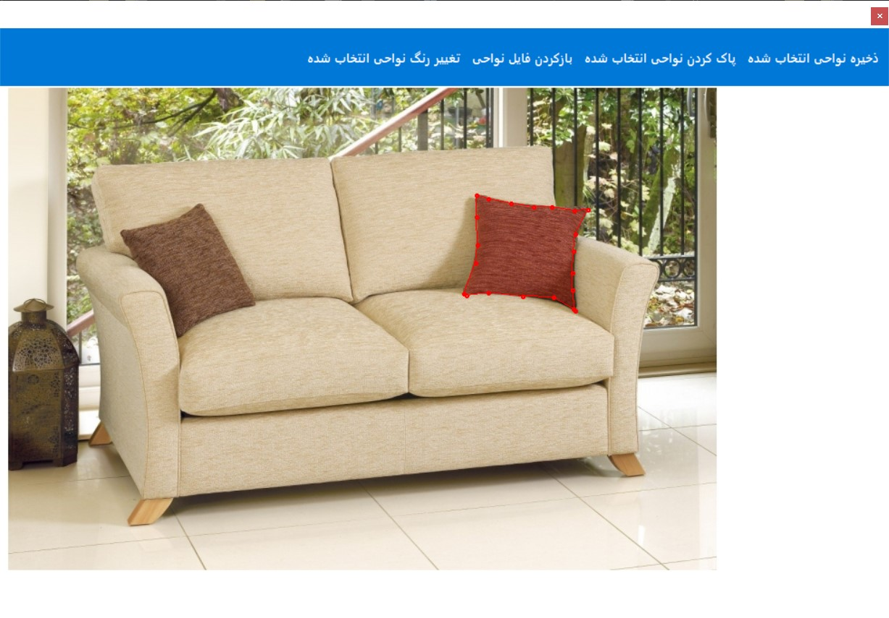
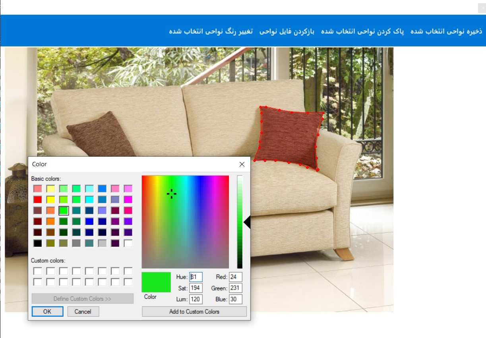
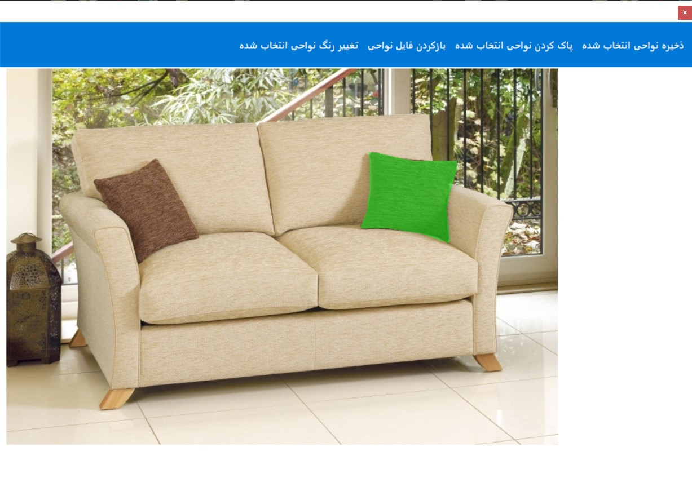

# 🎨 DecorationChanger – Preview New Colors for Furniture & Decor

A **C# WinForms desktop application** that lets you load a photo of a room, outline the decoration or furniture you want to change (e.g. a sofa), and instantly preview how it would look in a different color.





---

## 📖 Overview

`DecorationChanger` is a small visualisation tool for interior‑design previews.  
You open a reference image, draw a polygon around the object you want to recolor, and pick a new color from a standard color dialog. The app overlays the chosen color on that region so you can judge the result before committing to a purchase or paint job.

The project is a single‑form Windows Forms application. It uses **Accord.NET** for image loading and manipulation, and **Newtonsoft.Json** to save and reload the polygon regions you have drawn.

---

## ✨ Features

- **Load any room photo** – the app reads `x.jpg` from its working directory as the base image.
- **Draw polygon regions** – left‑click to add points, right‑click to close the shape and fill it with a translucent red preview.
- **Change the color of a region** – select a region set and choose a new color; the app overlays that color on every defined polygon.
- **Save region data** – export the clicked points (polygons) to a JSON file so you can reload them later.
- **Load region data** – restore previously saved polygons from JSON and continue editing.
- **Reset** – clear all points and regions and start over from the original image.
- **Save the result** – export the edited image as a JPEG alongside the JSON region file.

---

## 🗂️ Repository Structure

```text
DecorationChanger/
├── SHDeco/                       # Main WinForms project
│   ├── Properties/               # Assembly info, settings, resources
│   ├── Resources/                # Icons and UI resources
│   ├── bin/Debug/                # Build output (generated)
│   ├── obj/Debug/                # Intermediate build files (generated)
│   ├── App.config                # Application configuration
│   ├── Form1.cs                  # All application logic (click handling, coloring, save/load)
│   ├── Form1.Designer.cs         # UI layout (PictureBox, ToolStrip, ColorDialog)
│   ├── Form1.resx                # Form resources
│   ├── Program.cs                # Entry point (launches Form1)
│   ├── SHDeco.csproj             # Project file (.NET Framework 4.5)
│   └── packages.config           # NuGet package list (if present)
├── 1.jpg, 2.jpg, 3.jpg           # Example/screenshot images
├── Packages.dgml                 # Visual Studio dependency graph
├── SHDeco.sln                    # Visual Studio solution
├── SHDeco.v12.suo                # Visual Studio solution user options (artefact)
└── README.md
```

## 🛠️ Technologies & Dependencies

|Item|Details|
|---|---|
|**Language**|C#|
|**UI framework**|Windows Forms (WinForms)|
|**Target framework**|.NET Framework **4.5**|
|**Image library**|**[Accord.NET](https://accord.net/) 3.8.0** (`Accord`, `Accord.Imaging`, `Accord.Math`, `Accord.Statistics`)|
|**JSON library**|**Newtonsoft.Json 11.0.2**|
|**IDE**|Visual Studio (solution `SHDeco.sln`)|

The project references the following NuGet packages (see `SHDeco.csproj`):

- `Accord.3.8.0`
- `Accord.Imaging.3.8.0`
- `Accord.Math.3.8.0`
- `Accord.Math.Core` (part of Accord.Math)
- `Accord.Statistics.3.8.0`
- `Newtonsoft.Json.11.0.2`

---
## 🚀 Getting Started

### Prerequisites

- **Windows** (WinForms is Windows‑only).
- **Visual Studio 2019/2022** with the **.NET desktop development** workload.
- **.NET Framework 4.5** targeting pack.
- **NuGet** package restore (the Accord and Newtonsoft packages are not committed to the repository).

### Build and Run

1. **Clone the repository**
    
    ```bash
    git clone https://github.com/alisepehrnia/DecorationChanger.git
    cd DecorationChanger
    ```
    
1. **Open the solution**
    - Open `SHDeco.sln` in Visual Studio.
2. **Restore NuGet packages**
    - Right‑click the solution → **Restore NuGet Packages**.  
        (The `.csproj` references the packages from `..\packages\…`.)
3. **Build and run**
    - Press **F5** or **Ctrl+F5**.

> **Important:** The application expects an image named **`x.jpg`** in its working directory (the `bin\Debug` folder by default). Copy any room photo into that folder and rename it to `x.jpg` before launching, or replace the hard‑coded filename in `Form1.cs` if you prefer a different name.

---
## 💻 Usage

1. **Prepare the base image**  
    Place a photo of the room (e.g. a sofa you want to recolor) in the application’s working directory and name it `x.jpg`.
2. **Launch the app**  
    The image loads into the picture box.
3. **Draw a region**
    - **Left‑click** around the object to add points. Each click draws a small red dot and connects it to the previous point.
    - **Right‑click** to close the polygon: the shape is filled with a translucent red overlay and stored as a region.
4. **Preview a new color**
    - Click the **color‑change** tool (the first toolstrip button).
    - Pick a color from the color dialog.
    - The app fills every stored region with that color (alpha‑blended at 150/255) so you can see the effect.
5. **Save your work**
    - Use the **save** toolstrip button to export:
        - a **JSON file** containing all polygon points, and
        - a **JPEG image** of the recolored result (saved as `<your‑filename>.jpg`).
6. **Reload later**
    - Use the **load** toolstrip button to open a previously saved JSON file; the polygons are redrawn and the regions are restored.
7. **Reset**
    - Use the **reset** toolstrip button to clear all points and regions and return to the original `x.jpg`.

---
## 🧠 How It Works (High Level)

- **Point collection** – `PictureBox1_Click` handles mouse events. Left clicks append `PointF` values to `clickedPoints`; right clicks close the polygon, create a `Region` from the points, fill it with a translucent red brush, and add an `SHRegion` object to `RegionsList`.
- **Region model** – `SHRegion` is a simple class holding a `List<PointF>` of clicked points.
- **Color overlay** – `toolStripButton1_Click` opens a `ColorDialog`; for each stored region it builds a `GraphicsPath`/`Region` and fills it with `Color.FromArgb(150, chosenColor)`.
- **Persistence** – `SaveRegionsData` serialises `RegionsList` to JSON with Newtonsoft.Json; `LoadRegionsData` deserialises it back.
- **Image handling** – [Accord.NET](https://accord.net/) is used to load the image (`Accord.Imaging.Image.FromFile`) and to draw/fill regions with `System.Drawing` graphics.

---
## 📝 Notes & Caveats

- **Hard‑coded image name** – the base image is always `x.jpg`. To use a different file, either rename your image or edit the `"x.jpg"` literals in `Form1.cs`.
- **Single‑form app** – all logic is in `Form1.cs`; there is no separate service or model layer.
- **Windows‑only** – WinForms and `System.Drawing` are not cross‑platform.
- **[Accord.NET](https://accord.net/) 3.8.0** – this is an older Accord release; if you upgrade, check API compatibility for `Accord.Imaging.Image.FromFile`.
- **No installer** – build and run from Visual Studio (or publish manually).
- **Example images** – `1.jpg`, `2.jpg`, and `3.jpg` in the repo root are screenshots/examples, not required by the application.

---
## 🤝 Contributing

Issues and pull requests are welcome — e.g. supporting drag‑and‑drop image loading, allowing multiple images per session, adding undo/redo for points, or replacing the hard‑coded `x.jpg` with a file picker.

---
## 📄 License

Feel free to use :)
